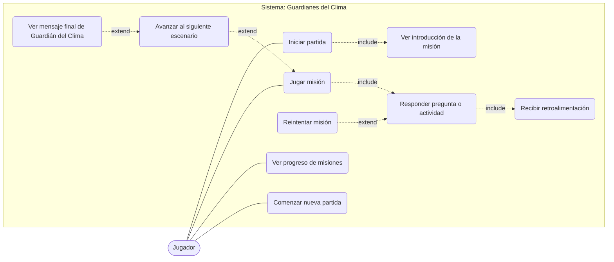

# Diagrama de casos de uso

Actor principal: **Jugador** (niño o niña).

## Descripción de los casos de uso

| Caso de uso | Descripción |
|---|---|
| Iniciar partida | El jugador comienza el juego desde la pantalla principal. |
| Ver introducción de la misión | Se explica quién es la protagonista y que debe convertirse en Guardiana del Clima. |
| Jugar misión | El jugador entra al escenario de una misión y ve los objetos de la tarea. |
| Responder pregunta o actividad | El jugador resuelve la pregunta o realiza la acción pedida. |
| Recibir retroalimentación | El sistema indica si la respuesta fue correcta o incorrecta. |
| Reintentar misión | Si la respuesta fue incorrecta, el jugador intenta de nuevo (extiende Responder). |
| Avanzar al siguiente escenario | Con una misión correcta, el jugador pasa a la siguiente (extiende Jugar misión). |
| Ver progreso de misiones | El jugador consulta qué misiones completó y cuáles faltan. |
| Ver mensaje final | Al completar las cinco misiones, se muestra la felicitación. |
| Comenzar nueva partida | El jugador reinicia el juego desde el principio. |
