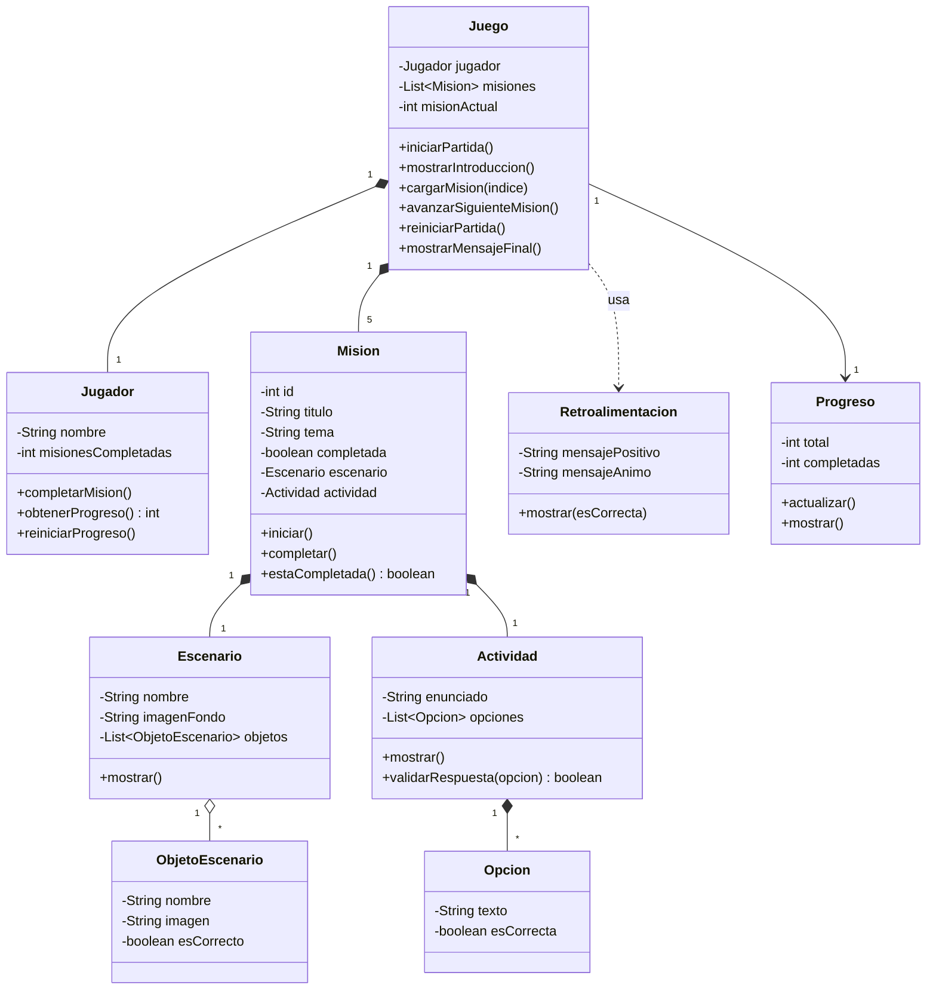

# Diagrama de clases

## Notas de diseño

- Las misiones, escenarios y preguntas son **datos** que se cargan en `Mision`, `Escenario` y `Actividad`. Así se pueden agregar o modificar sin reconstruir el juego (RNF-08).
- `Juego` controla el flujo y `Progreso` lleva el conteo de misiones completadas para mostrarlo al jugador (RF-10).
- `Actividad.validarRespuesta()` es el único punto donde se decide si una respuesta es correcta, lo que mantiene la validación consistente (RNF-04).
