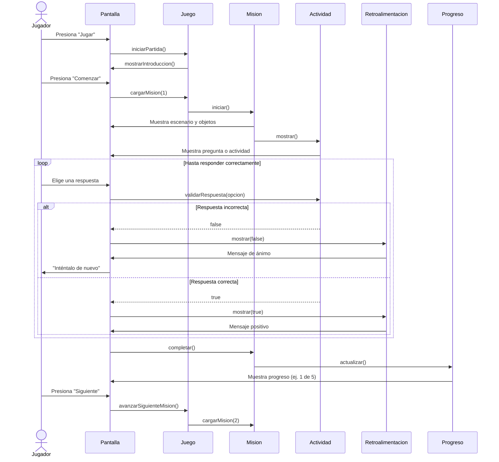

# Diagrama de secuencia

Escenario principal: **el jugador resuelve una misión**, con un intento incorrecto y uno correcto, y avanza al siguiente escenario.

Al completar la misión 5, `Juego` llama a `mostrarMensajeFinal()` y ofrece "Jugar de nuevo".
